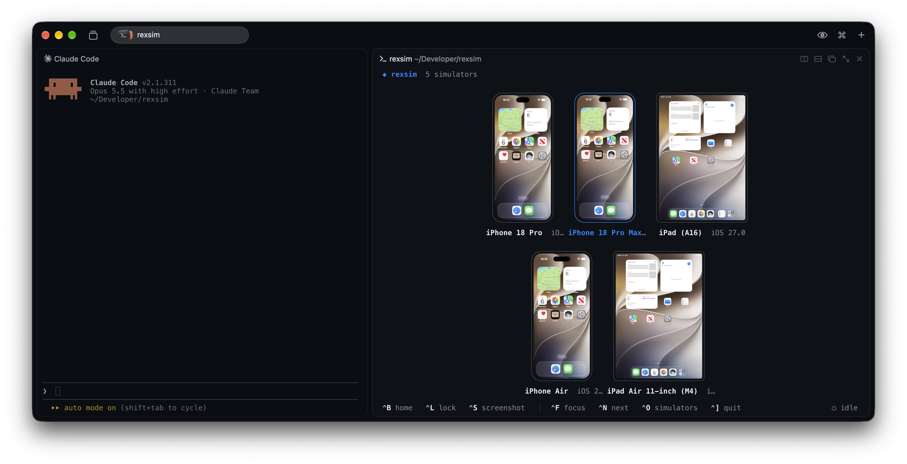

<h1 align="center">rexsim</h1>

<p align="center">iOS simulators and Android emulators in a <a href="https://www.superlogical.com/rex">Rex</a> pane, right next to your coding agent</p>



## Requirements

- Apple Silicon Mac
- Xcode with at least one iOS simulator, or Android Studio with at least one
  emulator (AVD)
- [Rex](https://www.superlogical.com/rex)
- For simulators, Meta's [idb_companion](https://github.com/facebook/idb), which rexsim downloads on first run

rexsim finds the Android SDK through `ANDROID_HOME`, or in `~/Library/Android/sdk`.
It boots emulators without a window, and connects to ones that are already
running through the emulator's own gRPC service.

## Install

```sh
curl -fsSL https://raw.githubusercontent.com/krozniata/rexsim/main/install.sh | sh
```

To upgrade, run the command above again.

Open it in Rex with <kbd>⇧</kbd> <kbd>⌘</kbd> <kbd>I</kbd>

## Agents

`rexsim show` puts devices in the Rex session's rexsim pane, opening one
beside the calling pane when there is none:

```sh
rexsim show                       # every booted simulator and emulator
rexsim show "iPhone 17" Pixel_9   # by name, UDID, AVD name or adb serial
```

`rexsim install` also writes a skill that tells agents to show the devices
they drive, for example before running e2e tests: to `~/.claude/skills/rexsim`
for Claude Code, and to `~/.agents/skills/rexsim` for Codex, OpenCode and Pi.
`rexsim uninstall` removes it.

## Keys

| Key | Does |
| --- | --- |
| ⌃B | Home |
| Esc | Back, on Android |
| ⌃R | Rotate clockwise |
| ⌃S | Screenshot to the agent |
| ⌃F | Focus one device |
| ⌃N | Next device |
| ⌃O | Show or hide devices |
| ⇧⌘I | Open or close rexsim |

MIT license. Third-party notices are in [THIRD_PARTY_NOTICES](THIRD_PARTY_NOTICES).
