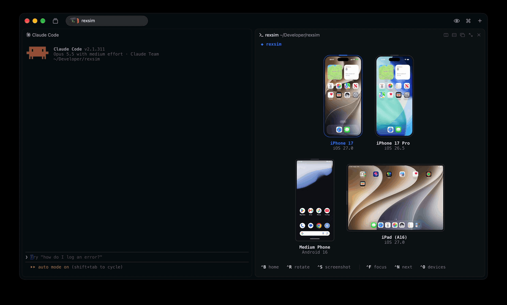

<h1 align="center">rexsim</h1>

<p align="center">
  <strong>iOS simulators and Android emulators in a <a href="https://www.superlogical.com/rex">Rex</a> pane, right next to your coding agent</strong>
</p>

<p align="center">
  <a href="https://github.com/krozniata/rexsim/releases/latest"></a>
  <a href="LICENSE"></a>
</p>

<p align="center">
  
</p>

## Features

- 🤖 **Agent driven**: your agent opens the devices it tests on, right beside it
- 📱 **One pane**: iPhones, iPads and Android phones side by side
- 🕹️ **Full control**: tap, swipe, type and rotate, or send your agent a screenshot

## Requirements

- Apple Silicon Mac
- [Rex](https://www.superlogical.com/rex)
- Xcode with a simulator, or Android Studio with an emulator

## Install

```sh
curl -fsSL https://raw.githubusercontent.com/krozniata/rexsim/main/install.sh | sh
```

To upgrade, run `rexsim upgrade`, or run the script again

## Usage

Press <kbd>⇧</kbd><kbd>⌘</kbd><kbd>I</kbd> to open the `rexsim` pane next to your agent

## License

MIT. 

Third-party notices are in [THIRD_PARTY_NOTICES](THIRD_PARTY_NOTICES).
